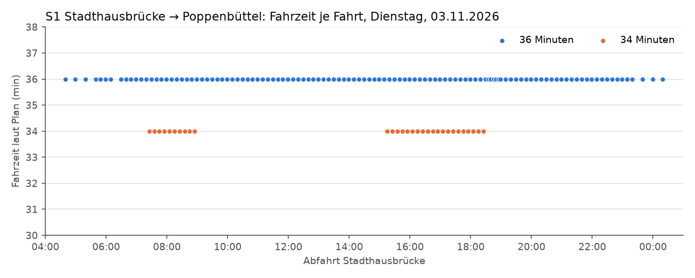
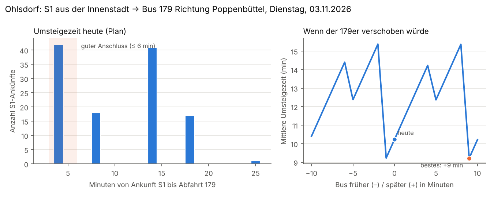

# Ergebnisse Stufe 1: Fahrplan-Analysen

Automatisch erzeugt am 18.10.2026 aus dem hvv-Soll-Fahrplan (gültig 20261002–20261212, Prüfsumme 2618dc1589da). **Alle Zahlen sind Plan-Werte ohne Verspätungen.** Was davon in der Realität ankommt, zeigt erst die Echtzeit-Erhebung ab Stufe 2.

Untersuchte Stichtage (typischer Fahrplan, kein Feiertag oder Sonderfahrplan): Werktag = Dienstag, 03.11.2026, Samstag = Samstag, 07.11.2026, Sonntag = Sonntag, 08.11.2026.

## F1: Warum dauert Stadthausbrücke → Poppenbüttel mal länger, mal kürzer?

**Kurz:** Laut Plan dauert die direkte Fahrt am Dienstag, 03.11.2026 entweder **34 oder 36 Minuten**. Der Unterschied entsteht fast vollständig beim **Halt in Ohlsdorf**: Die längeren Fahrten stehen dort im Schnitt 2,9 Minuten, die kürzeren nur 1,0 Minuten.

- 116 Fahrten brauchen 36 Minuten, 30 Fahrten (21 %) brauchen 34 Minuten.
- Die 34-Minuten-Fahrten starten nur in diesen Zeitfenstern: 07:25–08:55, 15:15–18:25.
- Bis Ohlsdorf sind beide gleich schnell (24,0 bzw. 24,0 Minuten). Von Ohlsdorf bis Poppenbüttel brauchen beide fast gleich lang (9,1 bzw. 9,0 Minuten).
- Gegenrichtung Poppenbüttel → Stadthausbrücke: 2 Fahrten mit 33 Minuten, 135 Fahrten mit 34 Minuten.

**Einordnung:** In Ohlsdorf wird die S1 planmäßig geteilt: Ein Zugteil fährt zum Flughafen, der andere nach Poppenbüttel. Fahrten mit langem Halt in Ohlsdorf passen zu diesem Teilen. Die kürzeren Fahrten mit kurzem Halt liegen in den Hauptverkehrszeiten und passen zu zusätzlichen Zügen, die nicht geteilt werden. Das ist eine Deutung aus den Haltezeiten; der Fahrplan selbst nennt den Grund nicht.

Eine Differenz von 30 statt 35 Minuten in der App lässt sich mit dem Fahrplan allein nicht erklären: Die App rechnet vermutlich andere Verbindungen mit ein (z. B. mit Umstieg, Fußweg oder Echtzeit). Das prüfen wir, sobald Echtzeitdaten vorliegen.

## F2: Planmäßige Fahr- und Haltezeiten je Abschnitt

Grundlage für die spätere Puffer-Analyse (Stufe 3): Wo der Plan mehr Zeit vorsieht als die Züge tatsächlich brauchen, steckt Puffer. Werte in Minuten, Durchschnitt über alle Fahrten des Werktags. Der Fahrplan rechnet in ganzen Minuten; Haltezeiten unter einer Minute erscheinen daher als 0.

| Halt | Fahrzeit vom vorigen Halt (36-min-Fahrten) | Haltezeit (36-min-Fahrten) | Fahrzeit vom vorigen Halt (34-min-Fahrten) | Haltezeit (34-min-Fahrten) |
| --- | --- | --- | --- | --- |
| Stadthausbrücke | – | – | – | – |
| Jungfernstieg | 1,0 | 1,0 | 1,0 | 1,0 |
| Hamburg Hbf | 2,0 | 1,0 | 2,0 | 1,0 |
| Berliner Tor | 2,0 | 0,0 | 2,0 | 0,0 |
| Landwehr | 3,0 | 0,0 | 3,0 | 0,0 |
| Hasselbrook | 2,0 | 0,0 | 2,0 | 0,0 |
| Wandsbeker Chaussee | 1,0 | 1,0 | 1,0 | 1,0 |
| Friedrichsberg | 1,0 | 1,0 | 1,0 | 1,0 |
| Barmbek | 2,0 | 0,0 | 2,0 | 0,0 |
| Alte Wöhr (Stadtpark) | 2,0 | 0,0 | 2,0 | 0,0 |
| Rübenkamp (City Nord) | 2,0 | 0,0 | 2,0 | 0,0 |
| Ohlsdorf | 2,0 | 2,9 | 2,0 | 1,0 |
| Kornweg (Klein Borstel) | 2,5 | 0,0 | 2,9 | 0,0 |
| Hoheneichen | 1,9 | 0,0 | 1,2 | 0,0 |
| Wellingsbüttel | 2,0 | 0,0 | 2,5 | 0,0 |
| Poppenbüttel | 2,7 | – | 2,4 | – |

## F7: Wie gut sind die Busse auf die S1 abgestimmt?

### Der 179er in Ohlsdorf (Richtung Poppenbüttel)

Für jede S1-Ankunft aus der Innenstadt in Ohlsdorf zwischen 06 und 20 Uhr: Wie lange dauert es bis zur nächsten Abfahrt des 179ers Richtung Poppenbüttel, wenn man mindestens 3 Minuten zum Umsteigen braucht?

- Die S1 kommt etwa alle 10 Minuten an, der 179er fährt etwa alle 20 Minuten.
- Mittlere Umsteigezeit heute: **10,2 Minuten**; guter Anschluss (≤ 6 Minuten) bei **35 %** der Ankünfte, mehr als 12 Minuten bei 50 %.
- Zum Vergleich: Läge der 179er rein zufällig zur S1, betrüge die mittlere Umsteigezeit etwa 12,6 Minuten. Die heutige Lage ist also **besser als Zufall**.
- Die beste Verschiebung (+9 Minuten) brächte nur 1,0 Minuten weniger im Schnitt (9,2 Minuten, guter Anschluss bei 35 %).

**Wichtig:** Weil der Bus nur halb so oft fährt wie die S1, kann eine Verschiebung höchstens jeden zweiten Zug gut anbinden. Die übrigen Ankünfte warten zwangsläufig lange. Eine spürbare Verbesserung für alle bringt nur ein dichterer Takt. Das ist eine Frage an den hvv, der laut Hochbahn den Takt festlegt.

### Rangliste: am schlechtesten abgestimmte Bus-Anschlüsse (S1 → Bus)

Buslinien an Ohlsdorf, Barmbek und Berliner Tor, die mindestens alle 20 Minuten fahren, im Tagesverkehr 06–20 Uhr. Sortiert nach der möglichen Ersparnis: Wie viel kürzer wäre die mittlere Umsteigezeit, wenn der Bus um bis zu ±10 Minuten anders läge? „Zufällige Lage“ ist der Durchschnitt über alle Verschiebungen, also der Wert ohne jede Abstimmung. Unberücksichtigt bleibt, dass ein Bus auch andere Anschlüsse bedient. Das ist eine Vorschau auf F8, keine fertige Empfehlung.

Insgesamt liegen 44 % dieser Verbindungen besser als bei zufälliger Lage.

| Knoten | Bus | Bus Richtung | S1 kommend | Bus-Takt | Ø heute | Ø bei zufälliger Lage | Ø bei bester Lage | Mögliche Ersparnis |
| --- | --- | --- | --- | --- | --- | --- | --- | --- |
| Barmbek | 172 | Lentersweg | Richtung Innenstadt/Wedel | 20 min | 15,8 min | 12,5 min | 9,7 min (+1 min) | 6,1 min |
| Barmbek | 172 | Mundsburger Brücke | Richtung Poppenbüttel/Flughafen | 10 min | 10,2 min | 7,5 min | 4,2 min (-9 min) | 6,1 min |
| Barmbek | 177 | Owiesenstraße | Richtung Poppenbüttel/Flughafen | 10 min | 9,5 min | 7,8 min | 4,4 min (-8 min) | 5,1 min |
| Barmbek | 277 | U S Barmbek | Richtung Innenstadt/Wedel | 20 min | 12,8 min | 10,0 min | 7,7 min (-8 min) | 5,1 min |
| Barmbek | 18 | Hauptbahnhof/ZOB | Richtung Innenstadt/Wedel | 10 min | 9,8 min | 7,5 min | 4,8 min (-8 min) | 5,1 min |
| Barmbek | 18 | Hauptbahnhof/ZOB | Richtung Poppenbüttel/Flughafen | 10 min | 9,2 min | 7,5 min | 4,2 min (-5 min) | 5,0 min |
| Ohlsdorf | 179 | S Poppenbüttel (Wentzelplatz) | Richtung Innenstadt/Wedel | 20 min | 15,1 min | 12,7 min | 10,2 min (+4 min) | 4,9 min |
| Barmbek | 171 | Thomas-Mann-Straße | Richtung Innenstadt/Wedel | 20 min | 15,1 min | 12,6 min | 10,4 min (-8 min) | 4,8 min |
| Ohlsdorf | 179 | U Borgweg | Richtung Poppenbüttel/Flughafen | 20 min | 13,6 min | 12,9 min | 9,5 min (+3 min) | 4,1 min |
| Barmbek | 17 | U Feldstraße | Richtung Innenstadt/Wedel | 10 min | 8,8 min | 7,5 min | 4,8 min (-7 min) | 4,1 min |
| Barmbek | 277 | U S Barmbek | Richtung Poppenbüttel/Flughafen | 20 min | 11,4 min | 10,2 min | 7,4 min (+5 min) | 4,0 min |
| Barmbek | 17 | U Feldstraße | Richtung Poppenbüttel/Flughafen | 10 min | 8,2 min | 7,5 min | 4,2 min (-4 min) | 4,0 min |
| Berliner Tor | 554 | Jungestraße | Richtung Poppenbüttel/Flughafen | 20 min | 12,9 min | 11,4 min | 8,9 min (-7 min) | 4,0 min |
| Barmbek | 37 | Im Grünen Grunde | Richtung Innenstadt/Wedel | 10 min | 9,1 min | 7,5 min | 5,1 min (+6 min) | 4,0 min |
| Barmbek | 171 | Thomas-Mann-Straße | Richtung Poppenbüttel/Flughafen | 20 min | 13,6 min | 12,6 min | 9,8 min (+5 min) | 3,8 min |

Alle Verbindungen in beide Umsteigerichtungen: [f7_anschluesse_werktag.csv](../ergebnisse/analysen/f7_anschluesse_werktag.csv).

## Methodik und Grenzen

- Quelle: hvv-Soll-Fahrplan (GTFS), unverändert archiviert als GitHub Release. Datenquelle: Hamburger Verkehrsverbund GmbH (hvv), Transparenzportal Hamburg; Lizenz: Datenlizenz Deutschland – Namensnennung – Version 2.0 (https://www.govdata.de/dl-de/by-2-0).
- Umsteigezeit = Abfahrt des Anschlusses minus Ankunft, mindestens 3 Minuten (Methodik D7). Es zählt die nächste erreichbare Abfahrt.
- Bus-Haltestellen gehören zu einem Knoten, wenn ihr Name mit „U S <Knoten>“ bzw. „S <Knoten>“ beginnt (offizielle hvv-Benennung). Einstellbar in `aufbereitung/knoten.json`.
- Anschluss-Analyse im Tagesverkehr 06–20 Uhr; Ankünfte in Betriebspausen des Anschlusses (über 60 Minuten ohne Abfahrt) zählen nicht. Schienenersatzverkehr wird nicht als S-Bahn gezählt.
- Plan-Werte in ganzen Minuten, ohne Verspätungen, ohne Fußwegunterschiede zwischen Haltestellen.
